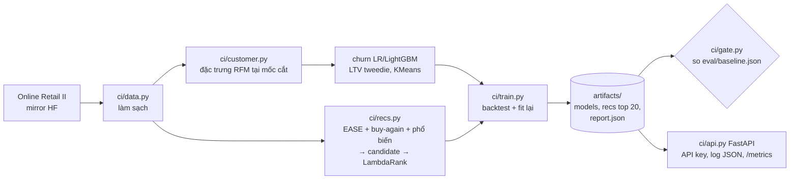

# Customer Intelligence: gợi ý sản phẩm, phân khúc, churn, LTV

Dự án dùng một bộ dữ liệu giao dịch thật cho bốn bài toán:

- gợi ý sản phẩm cho từng khách (candidate generation rồi learning-to-rank)
- phân khúc RFM bằng KMeans
- dự báo churn trong 90 ngày tới
- dự báo LTV (doanh thu 90 ngày tới)

Mọi kết quả đều được backtest theo thời gian. Có API phục vụ, Docker và CI.

**Dữ liệu:** UCI Online Retail II, một nhà bán sỉ quà tặng ở Anh, giai đoạn 12/2009 đến 12/2011. Sau khi làm sạch còn 794 nghìn dòng, 5.875 khách và 4.633 mã hàng. Lệnh `python -m ci.data` tải bản mirror trên Hugging Face về `data/raw/`.

## Thiết lập đánh giá (không rò rỉ tương lai)

```
2010-06-18 … 2011-06-13   5 mốc cắt train (cách nhau 90 ngày)
2011-06-13 → 2011-09-11   cửa sổ validation (chọn λ của EASE, train ranker)
2011-09-11 → 2011-12-10   cửa sổ test: 90 ngày cuối, mùa cao điểm Q4
```

- Đặc trưng tại mốc `c` chỉ dùng các dòng có `date < c`. Test `test_features_ignore_the_future` kiểm tra điều này: sửa dữ liệu sau mốc cắt thì đặc trưng không đổi.
- Quần thể đánh giá là khách có mua trong 365 ngày trước mốc cắt.
- Nhãn: `churn` = không mua lần nào trong 90 ngày sau mốc; `ltv` = doanh thu 90 ngày sau mốc.

## Kết quả trên tập test (`artifacts/report.json`)

### Churn (4.302 khách, tỉ lệ churn 49 %)

| Mô hình | ROC-AUC | PR-AUC | Lift top 10 % |
|---|---|---|---|
| Luật recency (khách lâu chưa mua thì churn) | 0,707 | 0,659 | 1,47 |
| Logistic regression (log + chuẩn hoá) | **0,769** | 0,706 | 1,50 |
| LightGBM | 0,764 | **0,713** | **1,55** |

### LTV 90 ngày

| Mô hình | MAE (£) | Spearman | Doanh thu nằm trong top 10 % dự đoán |
|---|---|---|---|
| Baseline: chi tiêu 365 ngày / 4 | 491,8 | 0,537 | 54,5 % |
| LightGBM (tweedie) | 495,9 | 0,548 | 54,9 % |
| Oracle (biết trước tương lai) | | | 70,4 % |

**Nhận xét trung thực:** với khoảng 4 nghìn khách và 16 đặc trưng RFM, mô hình phức tạp chỉ ngang hoặc nhỉnh hơn baseline đơn giản rất ít. Churn có thêm 6 điểm AUC so với luật recency, còn LTV thì gần như hoà. Đặc trưng mùa vụ `mon_ly` (chi tiêu cùng cửa sổ năm trước) chỉ tăng thêm khoảng 0,002. Muốn tăng thêm cần dữ liệu ngoài RFM, chẳng hạn kênh mua, web/app event hay giá.

### Phân khúc (KMeans trên log RFM, k = 4 chọn bằng silhouette 0,36)

Các phân khúc được kiểm chứng bằng hành vi thật trong 90 ngày tiếp theo:

| Phân khúc | Số khách | Recency (ngày) | Số hoá đơn / năm | Chi tiêu / năm | Churn 90 ngày sau | Doanh thu 90 ngày sau |
|---|---|---|---|---|---|---|
| 0 Champions | 637 | 17 | 11 | £3.972 | **9 %** | £2.706 |
| 1 Mới / mua thưa nhưng vừa mua | 603 | 19 | 2 | £657 | 43 % | £421 |
| 2 Đang nguội | 1.307 | 109 | 3 | £1.094 | 42 % | £435 |
| 3 Đã rời bỏ | 1.755 | 277 | 1 | £282 | 72 % | £229 |

Phân khúc 1 và 2 có tỉ lệ churn gần nhau nhưng vì lý do khác nhau, nên hành động cũng khác nhau. Phân khúc 1 cần onboarding và lôi kéo mua lần hai; phân khúc 2 cần chiến dịch win-back. Bản serving fit lại trên snapshot cuối cùng và silhouette chọn k = 3, nên số và thứ tự phân khúc trong API có thể khác bảng trên.

### Gợi ý sản phẩm (2.286 khách có mua trong cửa sổ test, 3.979 mã hàng)

| Mô hình | Recall@10 | NDCG@10 | HitRate@10 | Recall món mua lại | Recall món mới |
|---|---|---|---|---|---|
| Phổ biến 90 ngày | 0,035 | 0,104 | 0,52 | 0,067 | **0,018** |
| EASE (λ = 500) | 0,097 | 0,265 | 0,73 | 0,225 | 0,014 |
| Buy-again (món đã mua nhiều nhất) | 0,134 | 0,336 | 0,78 | 0,346 | 0,000 |
| **LightGBM LambdaRank** | **0,146** | **0,367** | **0,82** | **0,382** | 0,006 |

- **Candidate:** hợp của top 50 EASE, toàn bộ món khách từng mua và top 50 món phổ biến. Tập candidate bao được 45 % số món khách thật sự mua (candidate recall). Đây là trần của ranker.
- **Đặc trưng ranker:** điểm và hạng EASE, số lần khách mua món đó, số ngày từ lần mua cuối, độ phổ biến, tỉ lệ mua lại của món, giá, độ hoạt động của khách.
- **Bài học chính:** với khách sỉ, phần lớn đơn là mua lại. Baseline buy-again mạnh hơn hẳn EASE. Ranker thắng vì học được khi nào nên đẩy món cũ và khi nào nên đẩy món mới (NDCG +9 % so với buy-again). Recall món mới vẫn rất thấp. Nếu mục tiêu kinh doanh là khám phá sản phẩm thì cần một slot riêng trong danh sách gợi ý cho món mới.
- **Cold start:** khách mới nhận danh sách phổ biến. Món quá hiếm để có trong ma trận EASE (ít hơn 5 khách) dùng hàng xóm TF-IDF trên mô tả sản phẩm (content-based).

## Kiến trúc



**Quyết định thiết kế**

- **Backtest theo mốc cắt thời gian, không chia ngẫu nhiên:** đặc trưng chỉ dùng dữ liệu trước mốc; có test riêng kiểm tra rò rỉ tương lai.
- **Gợi ý hai tầng (candidate rồi ranker):** EASE và buy-again mỗi cái mạnh một phần (món mới / món mua lại); LambdaRank học cách trộn. Trần của ranker là candidate recall 45 %.
- **Gợi ý tính trước top 20 mỗi khách:** API chỉ tra cứu, không chạy model khi có request, nên latency thấp và không cần timeout cho inference.
- **Fallback:** khách không có trong snapshot nhận danh sách phổ biến (`source: popular_cold_start`); món hiếm dùng TF-IDF mô tả thay EASE.
- **Giữ logistic regression bên cạnh LightGBM:** hai model ngang nhau (AUC 0,769 và 0,764); LR dễ giải thích hệ số hơn.

## Chạy

```bash
uv venv -p 3.11 .venv && uv pip install -p .venv -r requirements.txt
.venv/Scripts/python -m ci.train          # ~10 phút trên CPU, ghi artifacts/
.venv/Scripts/python -m pytest -q         # 7 test, dữ liệu tổng hợp, ~45 s
.venv/Scripts/uvicorn ci.api:app --port 8000
docker build -t customer-intelligence . && docker run -p 8000:8000 -e CI_API_KEY=<key> customer-intelligence
.venv/Scripts/python -m ci.gate          # regression gate trên artifacts/report.json
```

| Endpoint | Trả về |
|---|---|
| `GET /customers/{id}` | phân khúc, xác suất churn, LTV 90 ngày, đặc trưng |
| `GET /recommend/{id}?k=10` | top k món từ ranker; khách mới nhận danh sách phổ biến |
| `GET /similar/{stock_code}` | món tương tự: EASE cho món phổ biến, TF-IDF cho món hiếm |
| `GET /metrics` | số request, latency p50/p95 theo route, version model |
| `POST /score` | chấm churn, LTV và phân khúc cho khách mới khi đặc trưng được tính ở upstream |

## MLOps

- **Regression gate** (`python -m ci.gate`, chạy trong CI): `artifacts/report.json` phải (1) không thấp hơn `eval/baseline.json` quá 0,02 ở churn AUC/PR-AUC, NDCG/Recall của ranker, Spearman LTV, và (2) thắng luật đơn giản trên cùng tập test (churn thắng luật recency, ranker thắng buy-again và phổ biến). LTV không có điều kiện "thắng baseline" vì hiện tại nó không thắng.
- **API:**
  - `CI_API_KEY` đặt thì mọi endpoint trừ `/health` cần header `X-API-Key`.
  - Giới hạn input: `k` từ 1 đến 20, `/score` tối đa 64 đặc trưng, giá trị phải hữu hạn; sai thì 422.
  - Thiếu artifact thì trả 503 kèm hướng dẫn, không 500.
  - Mỗi request ghi một dòng log JSON: `request_id` (nhận từ header `X-Request-ID` hoặc tự sinh, trả lại trong header), route, status, latency, `model_version` (12 ký tự đầu SHA-256 của `models.joblib`). Response chấm điểm cũng trả `model_version`.
  - `GET /metrics`: số request theo route và status, latency p50/p95 (1.000 request gần nhất mỗi route, trong bộ nhớ).

- **CI** (`.github/workflows/ci.yml`): chạy toàn bộ pipeline train trên một shop tổng hợp 300 khách và kiểm tra:
  - không rò rỉ tương lai
  - nhãn tính đúng
  - ranker phải thắng baseline phổ biến (quality gate)
  - các endpoint API hoạt động
- **Serving:** sau backtest, mô hình được fit lại với mọi mốc cắt đến T2, rồi chấm trên snapshot ngày cuối. Gợi ý được tính trước (top 20 mỗi khách) nên API chỉ cần tra cứu.

## Giới hạn và bước tiếp

- Chưa tune siêu tham số: LightGBM dùng tham số cố định hợp lý. Cũng chưa có MLflow; dự án `demand-forecasting` đã minh hoạ MLflow.
- Tập candidate chỉ bao 45 % món khách mua. Có thể thêm nguồn candidate theo đồng mua trong cùng hoá đơn, hoặc theo danh mục từ mô tả sản phẩm.
- Đã có log request và `/metrics` vận hành, nhưng chưa monitoring drift dữ liệu/điểm (PSI theo thời gian như `fraud-graph/`). Metrics nằm trong bộ nhớ một tiến trình.
- `python -m ci.train` mất khoảng 10 phút, phần lớn nằm ở bước dựng candidate và ma trận EASE. Chưa profile kỹ.
